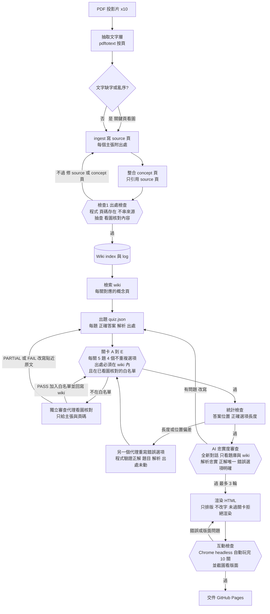

# 生成式 AI 入門:LLM Wiki + 闖關問答教學網頁

> 作業主題:用 LLM Wiki 做一份教學 HTML 簡報
> 主題:**生成式 AI 入門**(從神經網路、LLM 到 Agent 與工作流程)
> 呈現形式:**闖關問答版**——10 個關卡對應課程 10 個單元,每關 5 題,自選關卡,答完顯示解析與出處。

| 繳交項目 | 位置 |
|---|---|
| 教學網頁(闖關問答,10 關 × 5 題) | [`index.html`](index.html)(GitHub Pages 首頁) |
| LLM Wiki(網頁版) | [`wiki-site/index.html`](wiki-site/index.html) |
| LLM Wiki(原始 markdown) | [`wiki/`](wiki/):`CLAUDE.md`(schema)、`index.md`、`log.md`、`sources/`(10)、`concepts/`(15) |
| 題庫與檢查腳本 | [`tools/`](tools/):`quiz.json`、`check.py`、`build.py`、`verified.json` |

> 原始資料是 10 份課程投影片 PDF(生成式 AI 入門系列 01–10),因檔案大且為課程教材,**不放進此 repo**。題目、解析與 wiki 的每個主張都標了 `S06 p.16` 形式的出處(S+來源編號、p.投影片頁碼)。
> 一開始做的是 14 頁簡報版,後來依需求改成闖關問答版;簡報版保留在 git 歷史(commit `cfbf66e`)。

---

## 1. LLM Wiki 主題與簡介

**主題**:生成式 AI 入門。

**來源(ingest 了 10 份,作業要求至少 5 份)**:

| # | 內容 |
|---|---|
| 01 | 如何不焦慮地學 AI |
| 02 | 神經網路:呆萌型 AI 機器人與函數學習機 |
| 03 | AI 為什麼每次都不一樣 |
| 04 | LLM 只是在猜下一個字? |
| 05 | AI 怎麼記得前面說過什麼(RNN → Attention → Transformer) |
| 06 | 打造自己的對話機器人 |
| 07 | 讓 AI 看懂你的世界(RAG、記憶、LLM Wiki) |
| 08 | 教 AI 做事的方法(AI Agent) |
| 09 | 換你當老闆(Agentic Work) |
| 10 | 把你的工作拆成 AI 能做的流程(Loop、Graph) |

**三層架構**(依 LLM Wiki 的做法):raw sources(PDF,不可修改)→ wiki(LLM 寫的 markdown:10 個 source 頁 + 15 個 concept 頁 + index + log)→ schema(`wiki/CLAUDE.md`,規定頁面格式、ingest 流程與檢查點)。

**「先討論、後生成」**:先確認範圍(10 份全收)、頁面結構與檢查設計,確認後才生成。網頁形式也是先問過:使用者選了「小測驗」「暗色科技風」,並指定「用課程主題當關卡、每關 5 題、自選關卡、答完有解析」。

**題目怎麼來**:每題的正確答案與解析來自 wiki(標出處);**錯誤選項是出題時編寫的常見誤解,不出自 wiki**(網頁首頁也有註明)。

---

## 2. Loop / Graph 設計

### 流程圖



這是 **graph**(流程事先畫好、不能跳關、卡住退回特定一關),每一格內部再各有小 loop(例如「出題 → 關卡 → 改寫」)。設計參考課程 S10 的 Loop / Graph 與「主題 → HTML」案例(S10 p.24–26、p.40–48)。

### 哪些步驟會重複執行?
- **ingest**:每份 PDF 一輪(共 10 輪)。
- **出題 ↔ 關卡 / 審查 ↔ 改寫**:有問題就退回「出題」,不重跑整條流程(小圈);規定最多 3 輪(S10 p.23 的剎車:硬上限、資料不足就停)。
- **圖片核對 → 白名單 → 回寫 wiki**:每次核對完,通過的頁加進白名單,並把結果寫回 wiki,下次不用重核。

### 哪些地方需要檢查或重新生成?

| 關卡 | 類型 | 檢查什麼 | 不過怎麼辦 |
|---|---|---|---|
| 檢查 1(ingest 後) | 程式 + 抽查 | 出處頁碼在 PDF 頁數內、不串來源;抽查頁面內容對得上 | 退回 source / concept 頁 |
| 關卡 A/B/E | 程式 | 10 關、每關 5 題、每題 4 個不重複選項、答案合法、有解析與出處 | 退回出題 |
| 關卡 C | 程式 | 引用的頁碼必須出現在 wiki 內(不能憑空) | 退回出題 |
| 關卡 D | 程式 | 引用頁必須在「已看圖核對」白名單(`tools/verified.json`) | 送獨立審查代理看圖核對 |
| 統計檢查 | 程式 | 答案位置分布、正確選項是否常常最長(學生可憑長度猜) | 重寫錯誤選項 |
| 忠實度審查 | AI(全新對話) | 解析與正確選項是否忠於 wiki、正解是否唯一、錯誤選項是否明確錯誤 | 退回出題改寫 |
| 互動檢查 | 程式 + 看圖 | 10 關 × 5 題自動玩完、每題恰 1 個正解、有解析與出處、無 JS 錯誤;桌機與手機版面 | 退回渲染 |

### 為什麼這樣設計?
1. **程式檢查與 AI 審查分開**:頁碼存不存在、出處有沒有,交給腳本(不會被說服);「有沒有講偏」才交給 AI。課程 S10 p.22 的原則:做完了不是 AI 說了算,是腳本說了算;而且 AI 審查要開新對話,只給成品與來源。
2. **PDF 文字層不可信**:一開始就發現抽出的文字缺字、順序亂(例如「換你當 闆」)。所以只信「看過頁面圖片」的頁,其餘當索引用。
3. **渲染階段不能改字**(S10 p.44):`build.py` 先跑 `check.py`,不過就拒絕渲染。
4. **題目與 wiki 可對照**:每題解析後面的 `S03 p.94` 標籤、「延伸閱讀」連結,讓學生能一路追到 wiki 與來源頁。

---

## 3. 一次實際執行的結果與檢查紀錄

完整紀錄在 [`wiki/log.md`](wiki/log.md)。摘要:

**Ingest(10 份 PDF)**
- 抽取文字約 17 萬字;**文字層缺字、順序亂**,各份用頁面圖片核對的比例不同(06 全 80 頁、09 全 36 頁、10 除 1 頁外全部;02、05、03、04、01、07、08 僅部分)。
- 檢查 1(程式):10 份 source 頁約 1,000 個出處,頁碼全在合法範圍、無串錯來源。
- 檢查 1(抽查 4 處,看頁面圖片):S02 p.87 ✓、S03 p.62 ✓(並手算 0.26 / 0.24)、S02 p.118(投影片自己的文字與程式碼不一致,屬投影片筆誤,不採用)、**S05 p.45:抓到 1 處錯標頁碼**(「低位數頻率高」實際出自 p.43、p.47),已修正。
- Lint:15 個概念頁約 460 個出處,全部能在 source 頁找到;無失效連結、無孤立頁。

**第一次產出:14 頁簡報版(後來改成闖關版)**

| 階段 | 結果 |
|---|---|
| 關卡 A/B/C | 14 頁、89 個主張全部通過 |
| 關卡 D(白名單) | **22 項引用落在未核對頁,全數被擋下** |
| 獨立看圖核對這 22 項 | 17 項 PASS;**5 項 PARTIAL**(措辭超出投影片原文,例如把「標示吳恩達」寫成「吳恩達提出」) |
| AI 忠實度審查(89 項) | **14 項偏離**:9 項改寫、3 項(S08 未核對頁)看圖後成立、1 項(S06 p.17)看圖後屬實、1 項為說明句 |
| 渲染檢查 | 第 13 頁在 1280×720 內容超出 33 px、頁面選單蓋到內容 → 改版面後 14 頁 × 3 種尺寸皆無溢出 |

**第二次產出:闖關問答版(最終成品)**

| 階段 | 結果 |
|---|---|
| 出題 | 10 關 × 5 題 = 50 題,引用的頁沿用已核對的白名單與第一次的核對成果 |
| 關卡 A–E | 第一版即通過(出處全在 wiki、全在白名單) |
| **統計檢查** | 通過關卡後腳本統計發現:**50 題中 45 題的正確選項最長**(可憑長度猜答案)、28 題答案在 B。**頁碼與出處都對,所以前面的關卡抓不到** |
| 重寫錯誤選項 | 另一個代理只改錯誤選項;程式驗證題目、解析、出處、正確選項文字與原檔逐字相同(0 處違規)。結果(我重算):正確選項嚴格最長 9/50、另有 12 題與最長並列(多為數字或短選項),位置 13/13/12/12。子代理自報 8/50,差 1 題來自之後我改的兩個選項 |
| 人工複查干擾選項 | 子代理自報 7 個不夠確定;檢視後替換 1 個有爭議的選項 |
| AI 忠實度審查(50 題) | 2 題小問題、0 題需換正確答案:① 一個干擾選項「更穩」可被辯護 → 改掉;② 解析引句「一共 600 元」與 wiki 的「共 600 元」不一致,**看圖確認投影片原文是「一共」,wiki 自己轉述錯了** → 修正 wiki 並補出處;另補 S03 p.93 出處(看圖確認) |
| 互動檢查 | 10 關 × 5 題自動玩完:每題 4 選項、恰 1 個正解、有解析與出處、無 JS 錯誤;截圖確認桌機與手機版面 |
| 最終 | `check.py`:10 關、50 題、0 個失敗 |

---

## 4. 反思

**哪個節點最常出錯?**

最常出錯的是**把 wiki 寫成題目 / 簡報句子的那一步**(出題)。兩次產出都出現:
- 簡報版:89 個主張裡,22 項引用落在沒看過圖的頁、5 項措辭超出原文、14 項被審查認為偏離 wiki。
- 闖關版:引用都合格,但**題目設計本身有偏差**——正確選項太長,學生不用懂內容就能猜中。

其次是 ingest 的文字抽取:文字層缺字,而且有 1 處出處標錯頁碼(S05 p.45 ↔ p.43/p.47)。另外,**wiki 自己也會錯**:S08 p.24 的引句被寫成「共 600 元」,投影片原文是「一共 600 元」,是下游審查才發現。

**發現問題後,把檢查往前移到哪一步?**

- **白名單(關卡 D)**:在生成之前就規定只能引用看過圖的頁。這來自 ingest 階段發現「文字層不可信」,第一次生成前就放進流程。
- **統計檢查**:題目偏差(長度、位置)是「頁碼與出處都對」的錯誤,逐題審查也沒抓到(審查只看事實對不對),是腳本統計整份題庫才看出來。所以我把它加成獨立的關卡,放在 AI 審查**之前**,因為偏差不用花 AI 就能算出來。
- **核對結果回寫 wiki**:例如 `tool-use-and-patterns.md` 的核對狀態、「一共 600 元」的修正,下次不必重做,也讓 wiki 比來源摘要更準。

**有沒有因此修改 workflow / graph?為什麼?**

有,四處:
1. **渲染前加鎖**:`build.py` 先跑 `check.py`,不過就拒絕渲染,避免在渲染階段偷偷改字。
2. **新增「看圖核對 → 白名單 → 回寫 wiki」迴圈**:被擋下的引用不是直接刪,而是送去核對,通過就長期累積。
3. **新增統計檢查與「重寫錯誤選項」節點**,並規定重寫時正確選項、題目、解析、出處不可動,由**程式**驗證(而不是相信代理的自我回報)。
4. **互動檢查獨立成節點**:用瀏覽器自動玩完全部 10 關,而不是只看畫面。

**還沒做到、下次想改的**:
- 出題目前是我直接讀概念頁寫成 JSON。更好的做法是 S10 p.43–44 的**證據卡**:每題先抽出「允許引用的 wiki 原句」,題目與解析只能改寫這些句子,再與原句做字面比對。這樣能把措辭偏離再往前抓一步(目前靠事後的 AI 審查)。**尚未實作**。
- 錯誤選項不出自 wiki,品質靠審查把關;有少數題的干擾選項偏容易(例如第 10 關第 1 題),可再加強。

---

## 5. 重新建置

```bash
python3 -I tools/check.py   # 出處與題庫關卡:有失敗就 exit 1
python3 -I tools/build.py   # 先跑 check.py,通過才渲染 index.html 與 wiki-site/
```

操作:首頁選關卡(網址 `#L3` 直接開第 3 關)、點選項或按 `1`–`4` / `A`–`D` 作答、`Enter` 或 `→` 下一題、`Esc` 回選單;最佳成績存在瀏覽器 localStorage。
