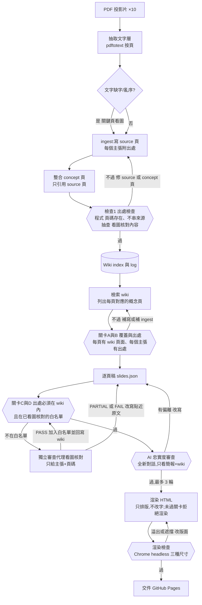

# 生成式 AI 入門:LLM Wiki + 教學 HTML 簡報

> 作業主題:用 LLM Wiki 做一份教學 HTML 簡報
> 主題:**生成式 AI 入門**(從神經網路、LLM 到 Agent 與工作流程)

| 繳交項目 | 位置 |
|---|---|
| 教學 HTML 簡報(14 頁) | [`index.html`](index.html)(GitHub Pages 首頁) |
| LLM Wiki(網頁版) | [`wiki-site/index.html`](wiki-site/index.html) |
| LLM Wiki(原始 markdown) | [`wiki/`](wiki/):`CLAUDE.md`(schema)、`index.md`、`log.md`、`sources/`(10)、`concepts/`(15) |
| 簡報內容與檢查腳本 | [`tools/`](tools/):`slides.json`、`check.py`、`build.py`、`verified.json` |

> 原始資料是 10 份課程投影片 PDF(生成式 AI 入門系列 01–10),因檔案大且為課程教材,**不放進此 repo**。Wiki 的每個主張都標了 `[S02 p.12]` 形式的出處(S+來源編號、p.投影片頁碼)。

---

## 1. LLM Wiki 主題與簡介

**主題**:生成式 AI 入門。

**來源(ingest 了 10 份,作業要求至少 5 份)**:

| # | 內容 |
|---|---|
| 01 | 如何不焦慮地學 AI |
| 02 | 神經網路:呆萌型 AI 機器人與函數學習機 |
| 03 | AI 為什麼每次都不一樣 |
| 04 | LLM 只是在猜下一個字? |
| 05 | AI 怎麼記得前面說過什麼(RNN → Attention → Transformer) |
| 06 | 打造自己的對話機器人 |
| 07 | 讓 AI 看懂你的世界(RAG、記憶、LLM Wiki) |
| 08 | 教 AI 做事的方法(AI Agent) |
| 09 | 換你當老闆(Agentic Work) |
| 10 | 把你的工作拆成 AI 能做的流程(Loop、Graph) |

**三層架構**(依 LLM Wiki 的做法):raw sources(PDF,不可修改)→ wiki(LLM 寫的 markdown:10 個 source 頁 + 15 個 concept 頁 + index + log)→ schema(`wiki/CLAUDE.md`,規定頁面格式、ingest 流程與檢查點)。

**「先討論、後生成」**:先確認範圍(10 份全收)、頁面結構、簡報大綱與檢查設計,確認後才生成;簡報大綱討論後沿用,語言決定為中文為主、英文術語括註。

---

## 2. Loop / Graph 設計

### 流程圖



這是 **graph**(流程事先畫好、不能跳關、卡住退回特定一關),每一格內部再各有小 loop(例如「逐頁稿 → 關卡 → 改寫」)。設計參考課程 S10 的 Loop / Graph 與「主題 → HTML 簡報」案例(S10 p.24–26、p.40–48)。

### 哪些步驟會重複執行?
- **ingest**:每份 PDF 一輪(共 10 輪)。
- **逐頁稿 ↔ 關卡 / 審查 ↔ 改寫**:有問題就退回「逐頁稿」,不重跑整條流程(小圈);規定最多 3 輪(S10 p.23 的剎車:硬上限、資料不足就停)。
- **圖片核對 → 白名單 → 回寫 wiki**:每次核對完,通過的頁加進白名單,並把結果寫回概念頁,下次不用重核。

### 哪些地方需要檢查或重新生成?

| 關卡 | 類型 | 檢查什麼 | 不過怎麼辦 |
|---|---|---|---|
| 檢查 1(ingest 後) | 程式 + 抽查 | 出處頁碼在 PDF 頁數內、不串來源;抽查頁面內容對得上 | 退回 source / concept 頁 |
| 關卡 A/B | 程式 | 每頁有對應 wiki 頁面;每個主張有出處 | 退回檢索,補寫或補 ingest |
| 關卡 C | 程式 | 簡報引用的頁碼必須出現在 wiki 內(不能憑空) | 退回逐頁稿 |
| 關卡 D | 程式 | 引用頁必須在「已看圖核對」白名單(`tools/verified.json`) | 送獨立審查代理看圖核對 |
| 忠實度審查 | AI(全新對話) | 每個主張與 wiki 同出處標籤的原句比對:數字、人名、語氣強度、來源是否被合併 | 退回逐頁稿改寫 |
| 渲染檢查 | 程式 + 看圖 | 14 頁、三種視窗尺寸無溢出、控制列不遮內容 | 退回渲染調版面 |

### 為什麼這樣設計?
1. **程式檢查與 AI 審查分開**:頁碼存不存在、出處有沒有,交給腳本(不會被說服);「有沒有講偏」才交給 AI。課程 S10 p.22 的原則:做完了不是 AI 說了算,是腳本說了算;而且 AI 審查要開新對話,只給成品與來源。
2. **PDF 文字層不可信**:一開始就發現抽出的文字缺字、順序亂(例如「換你當 闆」)。所以只信「看過頁面圖片」的頁,其餘當索引用。
3. **每個節點只看該看的**:渲染階段「不能改任何一個字」(S10 p.44),所以 `build.py` 在關卡未過時直接拒絕渲染。
4. **簡報與 wiki 可對照**:每個主張後面的 `S06 p.16` 標籤、每頁底部的「依據 wiki」連結,讓讀者能一路追到來源頁。

---

## 3. 一次實際執行的結果與檢查紀錄

完整紀錄在 [`wiki/log.md`](wiki/log.md)。摘要:

**Ingest(10 份 PDF)**
- 抽取文字約 17 萬字;**文字層缺字、順序亂**,各份用頁面圖片核對的比例不同(06 全 80 頁、09 全 36 頁、10 除 1 頁外全部;02、05、03、04、01、07、08 僅部分)。
- 檢查 1(程式):10 份 source 頁約 1,000 個出處,頁碼全在合法範圍、無串錯來源。
- 檢查 1(抽查 4 處,看頁面圖片):S02 p.87 ✓、S03 p.62 ✓(並手算 0.26 / 0.24)、S02 p.118(投影片自己的文字與程式碼不一致,屬投影片筆誤,不採用)、**S05 p.45:抓到 1 處錯標頁碼**(「低位數頻率高」實際出自 p.43、p.47),已修正。
- Lint:15 個概念頁約 460 個出處,全部能在 source 頁找到;無失效連結、無孤立頁。

**簡報生成(第一次完整執行)**

| 階段 | 結果 |
|---|---|
| 關卡 A/B/C | 14 頁、89 個主張全部通過 |
| 關卡 D(白名單) | **22 項引用落在未核對頁,全數被擋下** |
| 獨立看圖核對這 22 項 | 17 項 PASS;**5 項 PARTIAL**(措辭超出投影片原文,例如把「標示吳恩達」寫成「吳恩達提出」、把「一共 600 元」寫成「共 600 元」) |
| AI 忠實度審查(89 項) | **14 項偏離**:9 項需改寫、3 項(S08 未核對頁)看圖後成立、1 項(S06 p.17)看圖後屬實、1 項為說明句 |
| 渲染檢查 | 第一版:第 13 頁在 1280×720 內容超出 33 px,且頁面選單浮在內容上蓋到邊緣;改版後 14 頁 × 3 種尺寸皆無溢出 |
| 最終 | `check.py`:14 頁、89 個主張、125 個出處引用、**0 個失敗** |

---

## 4. 反思

**哪個節點最常出錯?**

最常出錯的是**把 wiki 寫成逐頁稿的那一步**(`slides.json`)。第一次生成的 89 個主張裡:22 項引用落在沒看過圖的頁、5 項措辭超出原文、14 項被審查認為偏離 wiki(多加了原文沒有的話、把兩頁合成一句、語氣被放大)。

其次是 ingest 的文字抽取:文字層缺字,而且有 1 處出處標錯頁碼(S05 p.45 ↔ p.43/p.47)。

**發現問題後,把檢查往前移到哪一步?**

- 白名單(關卡 D)在**生成逐頁稿之前**就規定:只能引用看過圖的頁。這來自 ingest 階段發現「文字層不可信」,所以在第一次生成前就把它放進流程,不是等簡報寫完才檢查。
- 看圖核對發現的 PARTIAL 與審查發現的偏離,都指向同一件事:**我是讀概念頁後憑印象寫簡報句子**,所以會悄悄增減語氣。這類錯誤程式抓不到(頁碼和出處都是對的)。因此確定了兩件事:(1)AI 忠實度審查必須獨立成一個節點,不能省;(2)核對結果要**回寫 wiki**(例如 `tool-use-and-patterns.md` 的核對狀態),下次不必重做。

**有沒有因此修改 workflow / graph?為什麼?**

有,三處:
1. **渲染前加鎖**:`build.py` 先跑 `check.py`,不過就拒絕渲染,避免在渲染階段偷偷改字。
2. **新增「看圖核對 → 白名單 → 回寫 wiki」迴圈**:被關卡 D 擋下的引用不是直接刪,而是送去核對,通過就長期累積。
3. **渲染檢查獨立成節點**:用瀏覽器實際量測,發現第 13 頁內容超出 33 px;再看截圖,發現頁面選單浮在內容上蓋到邊緣,兩者都在這個節點才被抓到。

**還沒做到、下次想改的**:
逐頁稿目前是我直接從概念頁寫成 JSON。更好的做法是 S10 p.43–44 說的**證據卡**:每頁先抽出「允許引用的 wiki 原句」,逐頁稿只能改寫這些句子,而且改寫後要和原句做字面比對。這樣能把「措辭偏離」這類錯誤再往前抓一步(目前只能靠事後的 AI 審查)。這個設計**尚未實作**,所以上面的偏離是靠事後審查抓到的。

---

## 5. 重新建置

```bash
python3 -I tools/check.py   # 出處關卡:有失敗就 exit 1
python3 -I tools/build.py   # 先跑 check.py,通過才渲染 index.html 與 wiki-site/
```

簡報操作:`←` `→` 或空白鍵翻頁、手機左右滑動、右下角選單跳頁、網址 `#12` 直接開第 12 頁;列印可輸出 PDF。
